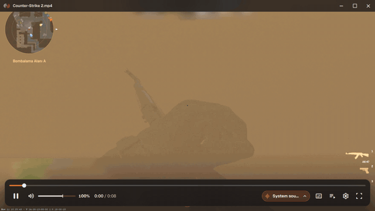
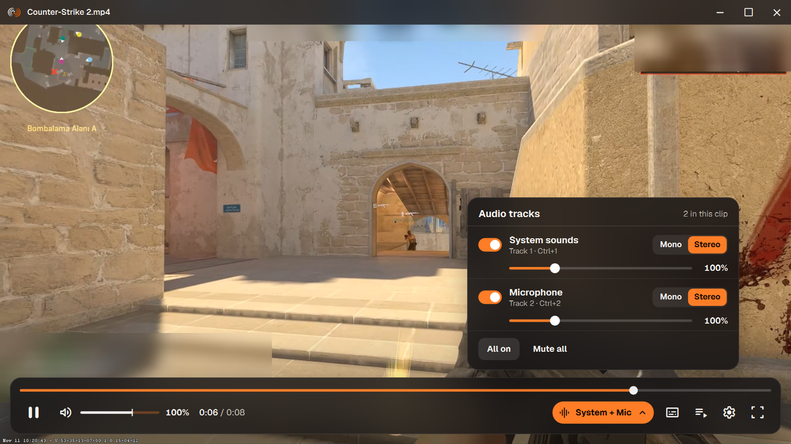
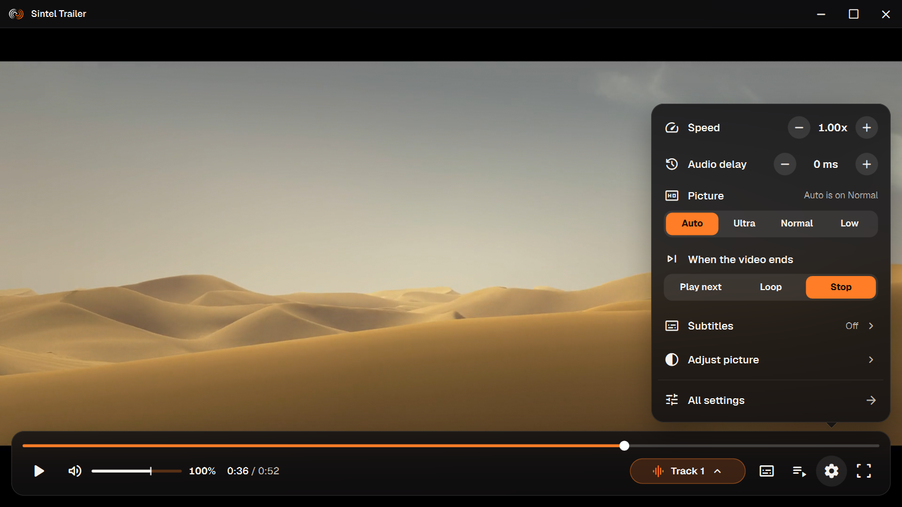
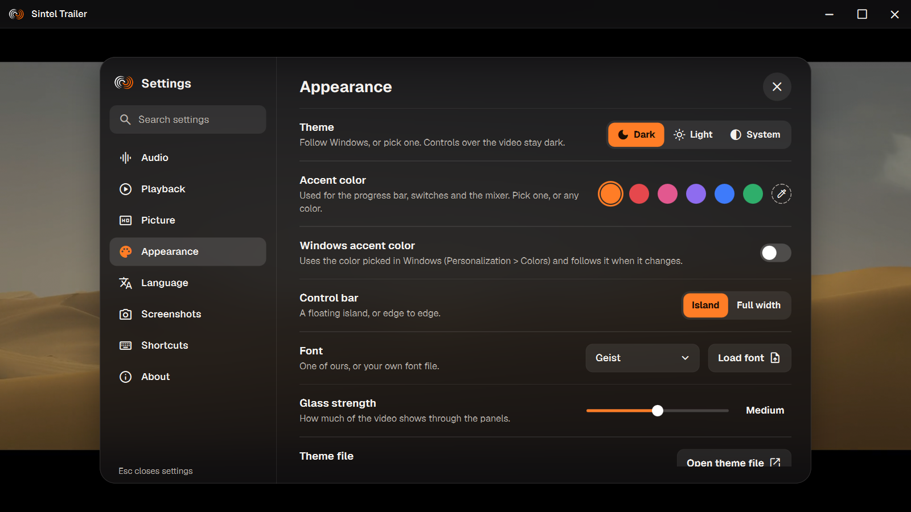
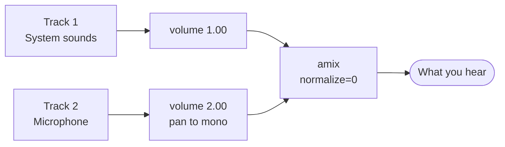

<div align="center">


# EchoPlay

**The video player for clips with separate game and mic tracks. Hear either one, or both mixed, live.**

[](#download)
[](#download)
[](#license)
<br>
[](https://isocpp.org)
[](https://www.qt.io)
[](https://mpv.io)
[](https://learn.microsoft.com/windows/win32/direct3d11/atoc-dx-graphics-direct3d-11)
[](https://cmake.org)

</div>

**NVIDIA ShadowPlay**, the **NVIDIA App** and **OBS Studio** (with multi-track audio) save your clips with the game
sound and your microphone on **two separate audio tracks**. Most players make you pick one, or send you to an editor to
mix them. EchoPlay plays **any mix of the tracks, live, without reopening the video**: one button on the control bar,
a switch and a volume per track, and it remembers your mix for the next clip. Nothing is exported or re-encoded.

<div align="center">

**[Download](#download)** · **[Quick start](#quick-start)** · **[Shortcuts](#keyboard-shortcuts)** ·
**[Report a bug](https://github.com/huseyincancalti/EchoPlay/issues/new)** ·
**[Add a language](#themes-and-languages)**

<br>



</div>

## Download

Pick the file for your system from **[Releases](https://github.com/huseyincancalti/EchoPlay/releases/latest)**:

| System | Version | File |
|---|---|---|
| Windows 10 and 11 | 2.1.0 | [EchoPlay-Setup.exe](https://github.com/huseyincancalti/EchoPlay/releases/latest/download/EchoPlay-Setup.exe) |
| macOS 15+, Apple silicon | 2.1.0 (test build) | [EchoPlay-2.1.0-arm64.dmg](https://github.com/huseyincancalti/EchoPlay/releases/download/v2.1.0/EchoPlay-2.1.0-arm64.dmg) |
| macOS, Apple silicon, older | 1.4.0 | [EchoPlay-1.4.0-arm64.dmg](https://github.com/huseyincancalti/EchoPlay/releases/download/v1.4.0/EchoPlay-1.4.0-arm64.dmg) |
| macOS, Intel | 1.4.0 | [EchoPlay-1.4.0-x86_64.dmg](https://github.com/huseyincancalti/EchoPlay/releases/download/v1.4.0/EchoPlay-1.4.0-x86_64.dmg) |
| Linux | 1.4.0 | [EchoPlay-1.4.0-x86_64.AppImage](https://github.com/huseyincancalti/EchoPlay/releases/download/v1.4.0/EchoPlay-1.4.0-x86_64.AppImage) |

EchoPlay 2 for macOS is a test build: it is built and started on Apple's machines in GitHub's CI, but not yet on a real
Mac. Intel Macs, older macOS and Linux keep 1.4.0 (mpv with EchoPlay's script) for now.

- **Windows:** the installer is not code-signed yet, so SmartScreen may say "Windows protected your PC": choose
  **More info → Run anyway**. It installs for your Windows user only, so it does not ask for administrator rights, and
  there is nothing else to install. Coming from 1.x? The setup replaces it in place; the
  [2.0.0 release notes](https://github.com/huseyincancalti/EchoPlay/releases/tag/v2.0.0) have a one-time cleanup command
  if you want every trace of the old version gone first.
- **macOS:** the app is not notarized by Apple, so the first start is blocked. Drag **EchoPlay** to Applications, open it
  once, then go to **System Settings → Privacy & Security** and choose **Open Anyway** next to EchoPlay. Only the first
  time. (On macOS 14 and older, right-click **EchoPlay** → **Open** also works.)
- **Linux:** run `chmod +x EchoPlay-*.AppImage` and start the file (some file managers need "Allow executing file as
  program" in its Properties first).
- EchoPlay tells you when a new version is out: a small card, then **Install** now or **Install on close** (on macOS,
  **Download** opens the release page).
  **Check now** in Settings → About looks right away.

<details>
<summary><b>macOS and Linux: the scripted install</b> (<code>install.sh</code>, if you already have mpv)</summary>

Download the source zip (**Code → Download ZIP**) and run:

```bash
bash install.sh                      # or: bash install.sh --config-dir <path>
```

It copies EchoPlay's config into `~/.config/mpv`, downloads uosc, thumbfast and memo, and prints the steps to make
EchoPlay your "Open with" player.

</details>

## Quick start

1. Open a clip: double-click it after **Settings → Playback → Default player**, or right-click a video → **Open with →
   EchoPlay**. A second clip opens in the window that is already running.
2. The mixer button on the control bar says what you hear (*System + Mic*). Click it: each track has its own switch,
   volume up to 400 % and a **Mono** switch for a mic that is only in one ear. **Ctrl+1**, **Ctrl+2** from the keyboard.
3. That's it. Your mix, volume, speed and the rest stay as you left them for the next clip, and a clip you stopped
   halfway asks to resume where you left off.

## Features

### The mixer

- **Any mix, live:** switch tracks on and off while the clip plays; the video never reopens or stutters.
- **Per track:** volume up to 400 %, mute, and mono for a one-ear microphone. **All on** and **Mute all** in one click.
- **Tracks say what they are:** the names your recorder wrote ("System sounds", "Microphone", "Commentary") and their
  language ("English", "Türkçe", "日本語"), for audio and subtitles. A track without a name is "Track 1", "Track 2".

<table>
  <tr>
    <td width="50%">
      
    </td>
    <td width="50%">
      
    </td>
  </tr>
</table>

### A player, not a toy

- **Fast:** starts in under a second and plays 4K60 recordings without dropped frames.
- **Everything a player should have:** seek-bar previews, chapters, A-B loop, frame step, press and hold for fast
  playback, the folder as a playlist, resume where you left off, screenshots and copy frame, media keys and taskbar
  buttons, subtitles with delay, size and position, audio delay, picture adjustments, media info.

### Make it yours

- Dark glass panels over the video and a floating control bar (or edge to edge); light, dark or the Windows setting.
- Your accent color, or Windows' own; one of our fonts or your font file; how much video shows through the glass.
- Shortcuts you can change; 7 languages: English, Türkçe, Español, Русский, 简体中文, 日本語, 한국어.
- Every color, radius, blur and font lives in one theme file: edit it and the look changes, no code.

<div align="center">

</div>

### EchoPlay vs. VLC, PotPlayer and mpv for clips with two audio tracks

| | VLC / PotPlayer | mpv | **EchoPlay** |
|---|---|---|---|
| Play one audio track | ✅ | ✅ | ✅ |
| **Mix several tracks together, live** | ❌ | ⚙️ by hand (`lavfi-complex`) | ✅ one click |
| Volume and mute per track | ❌ | ⚙️ by hand | ✅ |
| Fix a mic that is only in one ear (mono) | ❌ | ⚙️ by hand | ✅ one click |
| Remembers your mix | ❌ | ❌ | ✅ |
| Setup | Install | Install + config files | **One installer** |

## Keyboard shortcuts

Every shortcut can be changed in **Settings → Shortcuts**.

| Key | Action |
|---|---|
| `Space` | Play / pause (a click on the picture too) |
| `←` / `→` | Seek back / forward (the step is a setting); `Shift` for a fine step |
| `↑` / `↓` | Volume up / down (up to 300 %) |
| `M` | Mute |
| `Ctrl`+`1` / `2` / `3` | Track 1 / 2 / 3 on or off |
| `F` or double-click | Full screen |
| `G` | Fixed speed on or off; `S` / `D` slower / faster |
| `,` / `.` | Previous / next frame |
| `PgUp` / `PgDown` | Next / previous chapter |
| `L` | A-B loop |
| `<` / `>` | Previous / next file |
| `0`–`9` | Jump to 0 %–90 % of the clip |
| `F1` / `Shift`+`S` / `Ctrl`+`S` | Screenshot with subtitles / video only / the window |
| `Ctrl`+`C` | Copy the frame |
| `I` | Media info |
| `T` | Always on top |

## FAQ

**Why does my NVIDIA ShadowPlay / OBS recording have two audio tracks?**
NVIDIA's recorder and OBS Studio (with multi-track audio) save the game sound and your microphone as two tracks in the
same file instead of mixing them. Most players let you pick only one of them.

**Can I mix the two tracks without re-encoding the video?**
Yes, that's the point: EchoPlay rebuilds only the audio filter graph while the video keeps playing. Nothing is exported
or re-encoded.

**Why are my tracks called "System sounds" and "Microphone"?**
That's how the NVIDIA recorder names them inside the file. EchoPlay shows whatever name the recorder, or whoever made
the file, wrote.

## Where EchoPlay keeps things

| What | Where (Windows) |
|---|---|
| The program | `%LOCALAPPDATA%\Programs\EchoPlay\` |
| Your settings and mix | `%LOCALAPPDATA%\EchoPlay\state.json` |
| Where you left off in each clip | `%LOCALAPPDATA%\EchoPlay\resume.json` |
| Screenshots | `%LOCALAPPDATA%\EchoPlay\Screenshots\` by default; Desktop, Videos, Pictures, next to the clip or any folder in **Settings → Screenshots** |
| Fonts you loaded | `%LOCALAPPDATA%\EchoPlay\fonts\` |

The only network request EchoPlay makes is the version check to GitHub releases. Your clips never leave your PC.

## How it works

| Path | What it is |
|---|---|
| [`app/`](app/) | EchoPlay 2: C++ (`src/`) and Qt Quick (`qml/`) on libmpv's render API, Direct3D 11 on Qt's own device, so the glass panels blur the live video |
| [`app/lang/*.json`](app/lang) | One file per language |
| [`app/theme/theme.json`](app/theme/theme.json) | Every color, radius, blur and font, as tokens |
| [`installer/windows/v2/`](installer/windows/v2) | The Inno Setup script for `EchoPlay-Setup.exe` |
| [`tools/`](tools) | Build, test and measure: `check.sh`, `e2e.sh`, `package-v2.sh`, `bench.sh` |
| [`mpv/`](mpv), [`installer/`](installer) | EchoPlay 1.x (mpv + uosc + one Lua script), still the macOS and Linux build |

The mixer turns the enabled tracks into one filter graph and hands it to mpv while the clip plays:



```text
# two tracks enabled, track 2 boosted to 200% and forced mono:
[aid1]volume=1.00[ev1];
[aid2]volume=2.00,pan=stereo|c0=0.5*c0+0.5*c1|c1=0.5*c0+0.5*c1[ev2];
[ev1][ev2]amix=inputs=2:normalize=0[ao]
```

One track at its normal volume needs no filter at all (`aid=N`).

### Build from source

| You need | Version |
|---|---|
| Windows 10 or 11, 64-bit | with [Git for Windows](https://git-scm.com) (its Bash runs the scripts) |
| [Python](https://www.python.org) | 3 (`setup-dev.sh` puts aqtinstall, CMake and Ninja in its own venv) |
| [Inno Setup](https://jrsoftware.org/isinfo.php) | 6, only for the installer |

```bash
git clone https://github.com/huseyincancalti/EchoPlay.git
cd EchoPlay
bash tools/setup-dev.sh      # one time: Qt 6.10 (MinGW), CMake, Ninja, libmpv into ~/.echoplay-dev
bash tools/check.sh v2       # configure, build and the unit tests
bash tools/e2e.sh            # the real player window, driven by synthetic input
bash tools/package-v2.sh     # the installer: installer/windows/v2/Output/EchoPlay-Setup.exe
```

No admin rights, no Qt account, no keys.

## Themes and languages

- **A language** is one file, `app/lang/<code>.json`: copy `en.json`, translate the values and set `lang_name` to the
  language's own name. EchoPlay lists it by itself, no rebuild. Send it as a pull request.
- **The theme** is `app/theme/theme.json` (installed next to `EchoPlay.exe`): colors, radii, blur, fonts and opacity as
  tokens. **Settings → Appearance → Theme file** opens it.

## Contributing

Bug reports, translations and code are all welcome. See [CONTRIBUTING.md](CONTRIBUTING.md).

| I want to | Go to |
|---|---|
| Report something that does not work | [New issue](https://github.com/huseyincancalti/EchoPlay/issues/new) |
| Translate EchoPlay | [Themes and languages](#themes-and-languages), then a pull request |
| Send a fix | a pull request against `main`; CI builds and tests it on Windows |

## License

EchoPlay's own code is [MIT](LICENSE). EchoPlay 2 for Windows ships [libmpv](https://mpv.io) built with GPL parts, so
the Windows program as a whole is under the **GPL v3**; it also ships [Qt](https://www.qt.io) (LGPL v3) and the Vulkan
loader (Apache 2.0). Details and full texts: [app/THIRD_PARTY_NOTICES.md](app/THIRD_PARTY_NOTICES.md),
[`licenses/`](licenses/). EchoPlay 1.x bundles mpv, [uosc](https://github.com/tomasklaen/uosc),
[thumbfast](https://github.com/po5/thumbfast) and [memo](https://github.com/po5/memo):
[THIRD_PARTY_NOTICES.md](THIRD_PARTY_NOTICES.md).

Film in the screenshots: *Sintel* © Blender Foundation, [durian.blender.org](https://durian.blender.org), CC BY 3.0.

<br>

<div align="center">
<sub>Made by <a href="https://github.com/huseyincancalti">Hüseyin Can ÇALTI</a> · <a href="https://karakedidub.com">karakedidub.com</a>. If EchoPlay saved your clip, a ⭐ helps other players find it.</sub>
</div>
